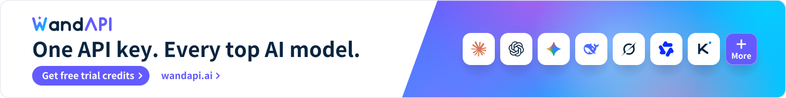
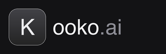
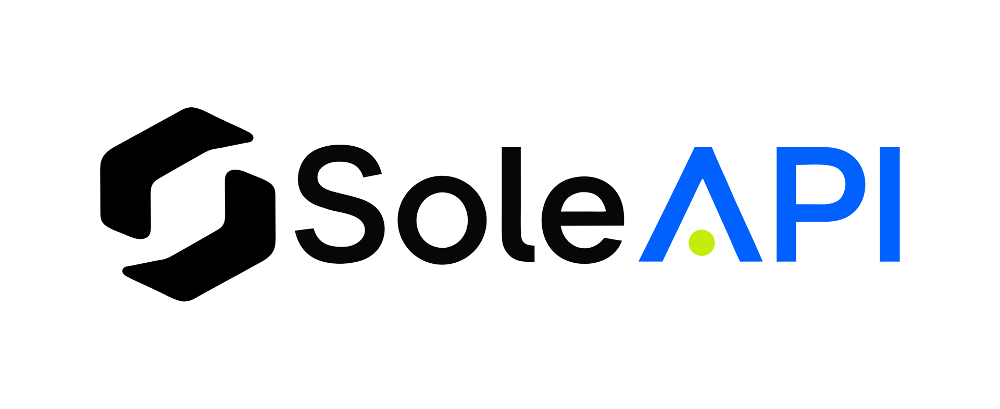

> **PK private edition:** For a fresh deployment, follow the [PK deployment guide (Chinese)](deploy/PK_DEPLOYMENT_CN.md). For migration, updates, rollback, and recovery, see [PK_MAINTENANCE.md](PK_MAINTENANCE.md). Source and formal releases come from the private `yb1320057104/sub2api` repository; current releases support `linux/amd64`. Use the verified assets attached to the selected private Release. A GHCR image is available only when that release explicitly records its publication. The upstream project introduction and author attribution are retained below.

Maintenance requirements: [Project constraints](PROJECT_CONSTRAINTS.md) · [PK feature register](PK_FEATURES.md). Preserve every registered feature when merging upstream; register new customizations in the same change.

<div align="center">


# Sub2API

[](https://golang.org/)
[](https://vuejs.org/)
[](https://www.postgresql.org/)
[](https://redis.io/)
[](https://www.docker.com/)


**PK 私有版 Sub2API**

基于 Wei-Shaw/sub2api，并集成 ranxi2001/sub2api 的功能；上游来源仅用于代码与许可溯源，正式发行走本私库。

[平台](https://tosky.io/) · [使用文档](https://tosky.io/docs/) · [版本下载](https://github.com/yb1320057104/sub2api/releases) · [问题反馈](https://github.com/ranxi2001/sub2api/issues)

中文 | [English](README_EN.md) | [日本語](README_JA.md)

</div>

## 上游社区与历史赞助

欢迎正在部署、使用或维护 Sub2API 的朋友加入 QQ 群「中转技术交流」（群号 **1004036018**），交流部署实践、协议兼容、出口代理和功能改进。也欢迎参与问题复现、测试、文档补充和 Pull Request，一起维护这个独立分支。

<details open>
<summary>Click to collapse</summary>

<p align="center"><a href="https://wandapi.ai/r/sub2api"><picture><source media="(prefers-color-scheme: dark)" srcset="assets/partners/banners/wandapi-en-dark.svg"></picture></a></p>

**[WandAPI](https://wandapi.ai/r/sub2api)** — an enterprise-grade, stable AI model API gateway built by a core contributor to this project. One API key gives you access to Claude, GPT, Gemini and other leading models, natively compatible with the OpenAI and Anthropic protocols, so Claude Code, Codex and your existing SDKs work by simply changing the Base URL. Real-time routing by latency and upstream health with millisecond-level automatic failover keeps requests online, backed by 99.99% service availability. Pay as you go, with per-request token and cost breakdowns.

**Free trial credits**: sign up via [this exclusive link](https://wandapi.ai/r/sub2api) to claim free trial credits.

---

<table>
<tr>
<td width="180"><a href="https://cctk.ai/register?aff=SUB2API"></a></td>
<td>Thanks to CCTK.AI for sponsoring this project! <a href="https://cctk.ai/register?aff=SUB2API">CCTK.AI</a> is an AI API gateway focused on stability and cost-effectiveness, offering fast relay services for Claude, OpenAI, Gemini, and other popular models. It works seamlessly with Claude Code, Codex, and other mainstream coding tools, delivering the same model capabilities at a fraction of the official cost. Register via <a href="https://cctk.ai/register?aff=SUB2API">this link</a> for faster, more stable, and more affordable AI API access.</td>
</tr>

<tr>
<td width="180"><a href="https://www.openmodel.ai?ref=sub2api"></a></td>
<td>One API, every top model! <a href="https://www.openmodel.ai?ref=sub2api">OpenModel</a> is a production-grade, high-availability AI API gateway that makes your applications truly fast and stable: automatic failover, smart routing to the best-performing channel, and a production-grade SLA. An SLA that far surpasses any single provider — making stability your core competitive advantage. Works directly with Claude Code, Codex, and Gemini CLI. Register via this link to get started.</td>
</tr>

<tr>
<td width="180"><a href="https://etok.ai"></a></td>
<td>Thanks to ETok.ai for sponsoring this project! ETok.ai is dedicated to building a one-stop AI programming tool service platform. We offer professional Claude Code packages and technical community services, with support for Google Gemini and OpenAI Codex. Through carefully designed plans and a professional tech community, we provide developers with reliable service guarantees and continuous technical support, making AI-assisted programming a true productivity tool. Click <a href="https://etok.ai">here</a> to register!</td>
</tr>

<tr>
<td width="180"><a href="https://apikey.fan/register?aff=SUB2API"></a></td>
<td>Thanks to APIKEY.FUN for sponsoring this project! <a href="https://apikey.fan/register?aff=SUB2API">APIKEY.FUN</a> is one of the core contributors to the sub2api open-source project, dedicated to providing open, stable, and cost-effective AI API access. The platform supports API relay services for Claude, OpenAI, Gemini, and other popular models, with pricing starting from as low as 7% of the original rate. Register via the exclusive link: <a href="https://apikey.fan/register?aff=SUB2API">APIKEY</a> to enjoy up to 5% off on all recharges.</td>
</tr>

<tr>
<td width="180"><a href="https://api.aigocode.dev/invite/SUB2API"></a></td>
<td>Thanks to AIGoCode for sponsoring this project! AIGoCode is an all-in-one platform that integrates Claude Code, Codex, and the latest Gemini models, providing you with stable, efficient, and highly cost-effective AI coding services. The platform offers flexible subscription plans, zero risk of account suspension, direct access with no VPN required, and lightning-fast responses. AIGoCode has prepared a special benefit for sub2api users: if you register via <a href="https://api.aigocode.dev/invite/SUB2API">this link</a>, you'll receive an extra 10% bonus credit on your first top-up!</td>
</tr>

<tr>
<td width="180"><a href="https://codex-everywhere.com"></a></td>
<td>Real GPT-5.6 series at 3% of OpenAI pricing — <a href="https://codex-everywhere.com">CodexEverywhere</a> is democratizing access to frontier models for developers worldwide. We believe in transparency and honesty, with model quality verified by active community oversight for months. USD and crypto friendly. Start with a free $20 trial at <a href="https://codex-everywhere.com">codex-everywhere.com</a>.</td>
</tr>

<tr>
<td width="180"><a href="https://bestproxy.com/?keyword=a2e8iuol"></a></td>
<td>Thanks to Bestproxy for sponsoring this project! <a href="https://bestproxy.com/?keyword=a2e8iuol">Bestproxy</a> provides high-purity residential IPs with dedicated one-IP-per-account support. By combining real home networks with fingerprint isolation, it enables link environment isolation and reduces the probability of association-based risk control.</td>
</tr>

<tr>
<td width="180"><a href="https://pateway.ai/?ch=1tsfr51"></a></td>
<td>Thanks to PatewayAI for sponsoring this project! <a href="https://pateway.ai/?ch=1tsfr51">PatewayAI</a> is a premium API relay built for heavy AI developers, offering the full Claude and Codex series sourced 100% from official providers, with transparent token-level billing. Enterprise plans include high concurrency, dedicated management, contracts, and invoicing. Register now to get $3 in trial credits, top-ups from 60% off, and referral bonuses up to $150.</td>
</tr>

<tr>
<td width="180"><a href="https://api.pptoken.cc/register?promo=SUB2API"></a></td>
<td>Thanks to PPToken.cc for sponsoring this project! <a href="https://api.pptoken.cc/register?promo=SUB2API">PPToken.cc</a> specializes in GPT model API relay services, supporting Codex, Claude Code, OpenAI-compatible clients, and Gemini CLI integration. Top-ups are 1:1 (¥1 = $1 credit); GPT models start at 0.16x rate multiplier, with overall cost at roughly 2.2% of official pricing and first-token latency around 1 second — ideal for developers seeking low-cost, high-speed access to GPT model capabilities. Technical support: 24/7 real human responses (no bots), @tech in the group chat and get a reply within 10 minutes. Sponsor benefit: the first 200 users who register via the <a href="https://api.pptoken.cc/register?promo=SUB2API">exclusive registration link</a> and enter promo code `SUB2API` can claim free Codex / Claude Code trial credits — no minimum spend, no card required.
</td>
</tr>

<tr>
<td width="180"><a href="https://veilx.io/#/hello/SJRBRVDV"></a></td>
<td>Thanks to Veilx for sponsoring this project! <a href="https://veilx.io/#/hello/SJRBRVDV">Veilx</a> CDN is purpose-built for large-scale AI API traffic, deeply optimized for relay services and call chains across OpenAI, Claude, Gemini, and scenarios like chat, image generation, embeddings, and streaming — delivering lower latency and higher stability under heavy concurrency. It also offers China three-network optimized return lines, making it ideal for global AI relay platforms, overseas AI SaaS, and cross-border high-concurrency deployments.
</td>
</tr>

<tr>
<td width="180"><a href="https://roxybrowser.com/invite/bgGKG7"></a></td>
<td>Thanks to RoxyBrowser for sponsoring this project! <a href="https://roxybrowser.com/invite/bgGKG7">RoxyBrowser</a> RoxyBrowser is the perfect partner for Sub2API: it features a built-in native Roxy AI Agent and high-quality native residential IPs, supports batch automation via simple commands, and significantly boosts security and efficiency for multi-account management! Click <a href="https://roxybrowser.com/invite/bgGKG7">this link</a> to sign up and receive a free residential IP package plus a 10% lifetime discount.
</td>
</tr>

<tr>
<td width="180"><a href="https://nagora.ai/"></a></td>
<td><a href="https://nagora.ai/">Nagora</a> is a multi-model AI API gateway built for developers and teams. With a single account and API key, you can access more than 26 leading text and image models through one unified interface. It is compatible with OpenAI, Anthropic, and Gemini protocols and integrates seamlessly with development tools such as Claude Code, Codex, and Gemini CLI. The platform provides intelligent routing, automatic failover, transparent pricing, and consolidated billing, along with budget management, rate limiting, and concurrency controls. This makes AI usage more reliable and manageable across individual development, team collaboration, and production environments. No changes to your existing application are required. Simply replace the Base URL and API key to complete the integration in as little as one minute.</td>
</tr>

<tr>
<td width="180"><a href="https://s.qiniu.com/u6rQrq"></a></td>
<td>Thanks to Qiniu AI for sponsoring this project! Qiniu AI is the enterprise-grade large-model MaaS platform under Qiniu Cloud (02567.HK), offering one-stop access to 150+ mainstream models worldwide, compatible with the protocols of major global model providers, and covering full-modality capabilities including text, image, audio, video, and file processing, serving over 1.69 million enterprises and developers. Qiniu AI offers an exclusive benefit for Sub2API users: register via <a href="https://s.qiniu.com/u6rQrq">this link</a> — enterprise users get 12 million tokens free, and developers get 3 million tokens free.</td>
</tr>

<tr>
<td width="180"><a href="https://api.fenno.ai/s/dC4k"></a></td>
<td>Thanks to FennoAI for sponsoring this project! FennoAI is a high-stability, high-performance API relay provider for enterprise R&D teams and developers, compatible with the OpenAI and Anthropic protocols and seamlessly integrating with mainstream AI coding tools such as Codex, Claude Code, and OpenCode. The platform delivers enterprise-grade stability, supporting call volumes of 100 billion tokens per day, and supports business-to-business settlement and invoicing for both domestic and overseas entities to meet enterprise R&D and procurement needs. As an exclusive benefit for Sub2API users, purchase a subscription via the <a href="https://api.fenno.ai/s/dC4k">exclusive link</a> to get $50 worth of Coding Plan credit for only $1.99. Referral rewards are also available: invite friends to purchase and earn up to 20% commission — the more you invite, the more you earn.</td>
</tr>

<tr>
<td width="180"><a href="https://lanox.ai/?c=6"></a></td>
<td>Thank you to LanoX AI for sponsoring this project! <a href="https://lanox.ai/?c=6">LanoX AI</a> provides stable, cost-effective global model access services for developers, teams, and enterprises. 🎁 New User Benefits — Claim millions of free tokens, plus 500+ free models for easier low-cost testing, validation, and deployment 🧠 Global Leading Models — GPT · Claude · Gemini · Qwen · Grok... 🎬 Multimodal Creation — Seedance 2.0 · GPT Image · Gemini Nano Banana 🛡️ Enterprise-Grade Reliability — High availability 💎 native capability output 💎 no intelligence degradation 💎 no model mixing 💎 transparent usage and billing 💎 💰 Lower API Costs — Top-tier models from as low as 10% of official pricing, with clear documentation, simple integration, invoicing support, and enterprise-scale batch usage 🏢 Enterprise Choice — Ideal for AI products, Agents, content platforms, and R&D teams with high-volume model usage</td>
</tr>

<tr>
<td width="180"><a href="https://www.rapidproxy.io/?ref=sub2api"></a></td>
<td><a href="https://www.rapidproxy.io/?ref=sub2api">RapidProxy</a> is a data collection proxy solution built for developers, providing stable and reliable residential proxy services. With 90M+ global residential IPs and 200+ country coverage, intelligent rotation, and precise geo-targeting, it helps projects such as web scraping, AI data training, SEO monitoring, and e-commerce data analysis break through access restrictions and improve data collection efficiency. It supports mainstream automation frameworks such as Playwright, Selenium, and Puppeteer, with prices as low as $0.65/GB — <a href="https://www.rapidproxy.io/?ref=sub2api">start your free test now</a>.</td>
</tr>

<tr>
<td width="180"><a href="https://hao.ai"></a></td>
<td><a href="https://hao.ai">hao.ai</a> is a high-speed, stable unified large-model API gateway for developers and teams. With a single API Key and a unified interface, you can access mainstream models such as GPT, Claude, and xAI Grok, with compatibility for common protocols and SDKs including OpenAI and Anthropic. The platform provides model routing, failover, team management, and complete request logs, with model prices as low as 15% of official reference pricing, helping users build AI applications more simply, more reliably, and at lower cost.</td>
</tr>

<tr>
<td width="180"><a href="https://www.swiftproxy.net/?ref=sub2api"></a></td>
<td>Swiftproxy is a high-performance proxy solution built for developers, providing stable and reliable residential and static residential proxy services. With 90M+ clean residential IPs, global coverage, flexible rotation, and precise geo-targeting, it helps projects such as web scraping, AI automation, browser automation, SEO monitoring, and multi-account management overcome access restrictions and improve workflow efficiency. It supports HTTP(S) and SOCKS5 protocols, integrates with popular automation tools like Playwright, Selenium, and Puppeteer, with dynamic proxy traffic that never expires until used and free testing available — <a href="https://www.swiftproxy.net/?ref=sub2api">start your free test now</a>!</td>
</tr>

<tr>
<td width="180"><a href="https://go.apimart.ai/gh-sub2api"></a></td>
<td>Thanks to APIMart for sponsoring this project! <a href="https://go.apimart.ai/gh-sub2api">APIMart</a> is a low-cost API platform for AI image and video generation — GPT-Image-2 from $0.006 per image, with 160+ images per dollar. One async API covers both image and video: submit a task, get an ID, and retrieve results via polling or callback. Batch tens of thousands of images without timeouts, and switch models without changing code. Pay as you go with no monthly fee — <a href="https://go.apimart.ai/gh-sub2api">sign up here</a> to get started.</td>
</tr>

<tr>
<td width="180"><a href="https://www.axisnow.io/"></a></td>
<td>Thanks to AxisNow for sponsoring this project! <a href="https://www.axisnow.io/">AxisNow</a> protects and accelerates websites and APIs, delivering an optimal access experience across mainland China and globally, while extending acceleration and security capabilities to native/mobile apps through client SDKs — <strong>self-hosted private-deployment CDN</strong> | <strong>subscription-based DDoS-protected CDN</strong> | <strong>autonomous, flexibly composable CDN network</strong>.</td>
</tr>

<tr>
<td width="180"><a href="https://pp.dog/register?aff=SUB2API"></a></td>
<td><a href="https://pp.dog/register?aff=SUB2API">PP.dog</a> is a source-level API gateway with its own massive account pool, purpose-built as an upstream relay for downstream transit stations and high-frequency developers — saving you the hassle of building and maintaining your own account pool. ✅ Direct from source: self-operated account pool with no middleman markup; 🧧 Cost crusher: combined rate multiplier as low as 0.03x, just 0.35% of official pricing; 🚀 Blazing fast: first-token latency < 1s, on par with the official native API. <a href="https://www.pp.dog/register?aff=SUB2API">Get started with PP.dog now</a></td>
</tr>

<tr>
<td width="180"><a href="https://colaproxy.com/?utm_source=sub2api&utm_medium=sub2api&ref=sub2api"></a></td>
<td>ColaProxy provides high-quality residential proxies built for web scraping, automation, and multi-account management. Get a free trial with non-expiring traffic, pricing starting as low as $0.3/GB, unlimited concurrent connections, and intelligent IP rotation for a smoother, more stable proxy experience. Use discount code COLA10 to get 10% off and start scaling your projects with reliable residential proxies today. <a href="https://colaproxy.com/?utm_source=sub2api&utm_medium=sub2api&ref=sub2api">Get started with ColaProxy</a></td>
</tr>

<tr>
<td width="180"><a href="https://modelflare.dev/sign-up?utm_source=github&utm_campaign=sub2api"></a></td>
<td>Modelflare: Full strength, stable, nothing watered down. Global SOTA models at a lower cost. Operated by US-based Havenbyte LLC, Modelflare supports GPT, Claude, Gemini, Grok, and other leading models through common compatible protocols, plus 40+ image and video models. Cache compensation is a highlight: selected OpenAI groups (price-first, stable, and premium) guarantee daily cache hit rates of 65%, 75%, or 85%, and if eligible requests fall short, Modelflare refunds the difference, visible on the usage dashboard after settlement. Special offers: a single top-up of US$20 unlocks the GPT discount group at a 0.015x price multiplier, and a single top-up of US$50 unlocks the Claude discount group at a 0.03x multiplier. Register via <a href="https://modelflare.dev/sign-up?utm_source=github&utm_campaign=sub2api">this exclusive link</a> to get started.</td>
</tr>

<tr>
<td width="180"><a href="https://x.com/chenju_ai"></a></td>
<td>Thanks to <a href="https://x.com/chenju_ai">Chenju</a> for sponsoring this project! This is probably the only ad slot in this section that doesn't ask you to sign up for anything. Good open-source projects deserve to be paid for, so Chenju is chipping in a gift and raising a glass to the author. Find <a href="https://x.com/chenju_ai">Chenju</a> on X to chat about API relays, upstream providers, or just shoot the breeze.</td>
</tr>

<tr>
<td width="180"><a href="https://t.me/AACC8888888"></a></td>
<td>🔑 Buying AI accounts at top prices | Gemini · Claude · GPT | Main and alt accounts all welcome, any channel wanted | Pay-per-usage supported | Seeking first-hand resources from major providers, I'll bring the KEY.<br>WeChat: Liuyou-zawd | Telegram: <a href="https://t.me/AACC8888888">AACC8888888</a></td>
</tr>

<tr>
<td width="180"><a href="https://niuproxy.com/?utm_source=sub2api&utm_medium=sub2api&ref=sub2api"></a></td>
<td><a href="https://niuproxy.com/?utm_source=sub2api&utm_medium=sub2api&ref=sub2api">NiuProxy</a> provides affordable global proxy solutions for web scraping, AI agents, automation, and data collection. With residential proxies starting at $0.35/GB across 190+ countries and regions, NiuProxy offers flexible plans and HTTP(S)/SOCKS5 support.<br>🎁 Use code PAY2 for 10% OFF your recharge!</td>
</tr>

<tr>
<td width="180"><a href="https://soleapi.com/r/sub2api"></a></td>
<td>Thanks to <a href="https://soleapi.com/r/sub2api">SoleAPI</a> for supporting this project! SoleAPI is an AI model gateway for developers and enterprises: one API key gives you access to 30+ leading models including Claude, GPT and Gemini. It is natively compatible with the OpenAI and Anthropic protocols, so Claude Code, Codex, Cursor and your existing SDKs work by simply changing the Base URL. Requests are routed in real time by latency and upstream health, with millisecond-level automatic failover to backup channels, 99.99% service availability and 24/7 technical support. Every call lands on a single bill with per-request token and cost breakdowns you can inspect at any time. Sign up through this project's <a href="https://soleapi.com/r/sub2api">referral link</a> to receive free trial credits, and earn ongoing cashback by inviting friends who top up!</td>
</tr>

</table>

</details>

## Overview

## 快速开始

新人部署、官方版替换、Excel / BPS 配置和质量运维步骤，请阅读[新人入门文档](docs/新人入门.md)。

账号检测、失败处置和自动恢复，请阅读[质量运维](docs/account-quality-operations.md)；BPS OAuth 登录、工具兼容和 403 恢复配置，请阅读[Excel / BPS 协议](docs/excel-bps.md)。

2.19.2 新增默认关闭的账号性能监控，支持指标阈值和独立暂停；启用、人工解除与区域传播边界见[账号性能监控](docs/account-performance-monitor.md)。

已经托管账号或完成部署，想在 Codex 中使用？请阅读[新人入门：使用 Sub2API 接入 Codex](docs/新人入门-使用Sub2API.md)，按步骤创建 API Key、配置 Cockpit Tools 并验证调用。


## 本仓库的维护方向

本仓库是 `ranxi2001/sub2api` 的独立生产 fork，基于 [Wei-Shaw/sub2api](https://github.com/Wei-Shaw/sub2api) 按需同步。应用功能、上游修复、Release 和生产验证都以 `production` 分支为准；不会用上游默认分支或 tag 直接覆盖本 fork 的生产历史。

- **DeepSeek 与 Codex 适配**：支持 Responses 到 Chat Completions 的转换、工具调用历史和上下文压缩兼容。配置模型映射后，可通过切换 API Key 分组使用 DeepSeek，沿用客户端配置。[操作教程](https://tosky.io/docs/?doc=deepseek-switch-group)
- **账号质量运维**：维护定时答题检测、判题记录、失败处置和自动恢复，支持按模型隔离及全部检测模型失败时移出指定分组。检测结果以实际回答和判题证据为准，不以票据形态判断质量。
- **Mihomo 出口管理**：维护订阅、动态代理、节点状态和账号业务出口；支持从订阅节点或动态代理单条、批量添加为静态代理，再给账号分别选择固定节点。[操作说明](docs/mihomo-static-node-proxies.md)
- **Excel / Basispoints**：维护模型级 BPS 路由、内嵌图片 HTTPS 中转、磁盘和并发保护、结构化输出校验，以及工具历史和 transport 恢复。路由遵循账号与模型配置；不支持的托管工具可按策略回退原生 Codex，或保持 BPS 并省略工具，具体边界见 [BPS 配置说明](docs/excel-bps.md)。
- **上游修复维护**：持续跟踪上游 Codex、Responses、工具调用、密文恢复和限流修复；先确认与本 fork 的行为差异，再按提交级别移植并补充回归测试。

已有代理任务报 `unsupported_encrypted_agent_message` 或 `encrypted_agent_recovery_*` 时，先保留任务及工具结果，按[加密代理任务续接与恢复边界](docs/openai-agent-continuation.md)核对实际通道和恢复条件。
- **独立发布与升级**：使用 `ranxi2001/sub2api` 的 Release、安装资源和容器镜像。版本变更见 [更新说明](https://github.com/yb1320057104/sub2api/releases)；Release 成功不代表生产服务已经部署，线上状态需要单独验证。

贡献代码时，请在独立分支中说明影响的请求路径、账号类型、配置默认值和兼容边界。涉及生产分支的修复应先进入原 PR head，通过 CI 后再合并；不要提交 Token、OAuth 导出、ticket、代理凭据或生产配置。

## 项目概述

Sub2API 是一个 AI API 网关平台，用于分发和管理 AI 产品订阅的 API 配额。用户通过平台生成的 API Key 调用上游 AI 服务，平台负责鉴权、计费、负载均衡和请求转发。

## 核心功能

- **多账号管理** - 支持多种上游账号类型（OAuth、API Key）
- **API Key 分发** - 为用户生成和管理 API Key
- **精确计费** - Token 级别的用量追踪和成本计算
- **智能调度** - 智能账号选择，支持粘性会话
- **并发控制** - 用户级、账号级和 API Key 级并发限制，支持可配置的 Key 等待队列
- **速率限制** - 可配置的请求和 Token 速率限制
- **内置支付系统** - 支持 EasyPay 易支付、支付宝官方、微信官方、Stripe，用户自助充值，无需独立部署支付服务（[配置指南](docs/PAYMENT_CN.md)）
- **USDT / USDC 加密货币支付** - 内置 BEpusdt 引擎，无需外部网关 API 或 Token；支持钱包管理、故障补扫、多网络充值与订阅购买，保留外接网关模式和幂等入账（[配置指南](docs/BEPUSDT_PAYMENT.md)）
- **管理后台** - Web 界面进行监控和管理
- **外部系统集成** - 支持通过 iframe 嵌入外部系统（如工单等），扩展管理后台功能

Current PK releases support `linux/amd64`. Deployment requires read access to the private `yb1320057104/sub2api` repository and its Release assets. The release may include a Docker image archive; do not assume that the same version has been pushed to GHCR. If using a published private image, verify its recorded identity and registry access separately.

- **Fresh deployment in an empty environment:** Follow the [PK deployment guide (Chinese)](deploy/PK_DEPLOYMENT_CN.md) for Docker Compose, authorization, configuration, and verification.
- **Migration or recovery of an existing service:** Follow [PK_MAINTENANCE.md](PK_MAINTENANCE.md) and preserve the existing database, application data, and secrets.

With the v0.2.14 bootstrap changes, a fresh installation generates a random administrator login email and password when their environment values are empty; retrieve generated values from the first-start logs (`Generated admin`). Explicit credentials must use a valid login email and a password of 8–72 bytes. Existing users and administrator credentials are preserved.

### Development and Packaging

The user's 2026-10-21 instruction replaces the earlier source-test prerequisite: review the protected features and final diff, then commit, merge and push private `main` together with one unused formal `vX.Y.Z-pk.N` tag. Full source suites and `refs/notes/pk-source-validation` are optional, not prerequisites for committing, merging or a new formal release. Do not run the full suites automatically or describe tests that were not run as passing. Follow [the maintenance workflow](PK_MAINTENANCE.md) and keep existing features and published tags intact.

The current pk.61 task authorizes local builds, isolated verification on the server, private publication of validated packages with `deploy/local-release.py`, and a separately controlled HA rollout. The publisher does not build artifacts or deploy services. This supersedes the older Jenkins-only restriction for this task. The release still requires an unused formal `vX.Y.Z-pk.N` tag whose commit belongs to private `main`, exact source and SHA256 checks, and all eleven isolated `pk-artifact-v2` runtime checks on the artifacts being published. The image and update archive must contain the same verified binary. Follow the current authorization and stage record in [project constraints](PROJECT_CONSTRAINTS.md) and the [pk.61 integration review](docs/PK_UPSTREAM_INTEGRATION_PK61_REVIEW.md); source checks alone do not establish publication or deployment.

Jenkins remains an available authorized runner. Its formal parameters are `ACTION=release`, `SOURCE_REF=vX.Y.Z-pk.N` (without `origin/`), and empty `COMMIT_SHA`/`PACKAGE_ID`; it enforces tag/main ancestry and the same artifact checks. Existing formal tags and sealed packages are immutable. Do not infer permission to publish or deploy from the availability of either runner.

Run source checks only when requested or needed for investigation. The optional server entry point uses an isolated environment; local Linux/WSL remains supported. Production data and services are excluded, credentials stay in ignored local configuration, and reports name the actual environment, scope and result. A full `pk-source-v2` passing report still requires all nine suites and preflight, matching commit/tree and original log hashes; partial or historical results cannot stand in for it.

```bash
# Optional full source validation after reviewing and staging the intended tree.
python -B scripts/test-server.py
# Optional evidence: bind only a genuinely passing report matching HEAD's tree.
python -B scripts/test-local.py --bind-commit HEAD --report /path/to/local-validation.json --publish-evidence
```

Optional local entries are `scripts/test-local.ps1` on Windows/WSL and `python3 scripts/test-local.py` on Linux. Old sealed `pk-source-artifact-v2` packages still require their original source and runtime evidence, and the legacy manual `pk-local-v1` path retains its ten-suite evidence requirements; never change a package profile to bypass validation. See [Jenkins instructions](deploy/jenkins/README.md) for that runner's manual `package`/`publish` and [release-tool scope](.github/release-tools/README.md) for the retained upstream helpers. The private formal Release retains its update archive and `checksums.txt` for the web updater. GitHub Actions is not this fork's release entry point. Publication and production rollout have separate verification records.

**Key configuration in `config.yaml`:**

```yaml
server:
  host: "0.0.0.0"
  port: 8080
  mode: "release"

database:
  host: "localhost"
  port: 5432
  user: "postgres"
  password: "your_password"
  dbname: "sub2api"

redis:
  host: "localhost"
  port: 6379
  username: ""
  password: ""

jwt:
  secret: "change-this-to-a-secure-random-string"
  expire_hour: 24

default:
  user_concurrency: 5
  user_balance: 0
  api_key_prefix: "sk-"
  rate_multiplier: 1.0
```

Additional security-related options are available in `config.yaml`:

- `cors.allowed_origins` for CORS allowlist
- `security.url_allowlist` for upstream/pricing/CRS host allowlists
- `security.url_allowlist.enabled` to disable URL validation (use with caution)
- `security.url_allowlist.allow_insecure_http` to allow HTTP URLs when validation is disabled
- `security.url_allowlist.allow_private_hosts` to allow private/local IP addresses
- `security.response_headers.enabled` to enable configurable response header filtering (disabled uses default allowlist)
- `security.csp` to control Content-Security-Policy headers
- `billing.circuit_breaker` to fail closed on billing errors
- `security.trust_forwarded_ip_for_api_key_acl` enables legacy raw forwarded-header takeover (enabled by default for upgrade compatibility); disable it to enforce `server.trusted_proxies`, which should contain only the exact proxy CIDRs that connect directly to Sub2API
- `security.forwarded_client_ip_headers` configures up to 16 third-party CDN client-IP header names; they are checked in order before the built-in headers only while legacy takeover is enabled
- `turnstile.required` to require Turnstile in release mode

Custom client-IP headers can be set in YAML or as a comma-separated environment variable:

```bash
SECURITY_FORWARDED_CLIENT_IP_HEADERS=True-Client-IP,X-CDN-Client-IP
```

Header names are validated, canonicalized, and de-duplicated. The admin security settings can update the list without a restart; new installations persist YAML/environment defaults and existing installations backfill a missing database value. When legacy takeover is disabled, all custom and built-in raw forwarding headers are ignored and Gin uses only `server.trusted_proxies`. While takeover is enabled, firewall the origin to CDN/proxy addresses and make the edge overwrite every trusted client-IP header. See [`deploy/EDGE_SECURITY.md`](deploy/EDGE_SECURITY.md) for the complete migration and trust-boundary rules.

**⚠️ Security Warning: HTTP URL Configuration**

When `security.url_allowlist.enabled=false`, the system performs minimal URL validation and **allows HTTP URLs by default** (dev-friendly mode; Docker Compose deployments use the same default). For production, explicitly tighten this to HTTPS-only:

```yaml
security:
  url_allowlist:
    enabled: false                # Disable allowlist checks
    allow_insecure_http: false    # HTTPS only (recommended for production)
```

**Or via environment variable:**

```bash
SECURITY_URL_ALLOWLIST_ENABLED=false
SECURITY_URL_ALLOWLIST_ALLOW_INSECURE_HTTP=false
```

**Risks of allowing HTTP:**
- API keys and data transmitted in **plaintext** (vulnerable to interception)
- Susceptible to **man-in-the-middle (MITM) attacks**
- **NOT suitable for production** environments

**When to use HTTP:**
- ✅ Development/testing with local servers (http://localhost)
- ✅ Internal networks with trusted endpoints
- ✅ Testing account connectivity before obtaining HTTPS
- ❌ Production environments (use HTTPS only)

**Example error for HTTP URLs when `allow_insecure_http: false` is set:**
```
Invalid base URL: invalid url scheme: http
```

If you disable URL validation or response header filtering, harden your network layer:
- Enforce an egress allowlist for upstream domains/IPs
- Block private/loopback/link-local ranges
- Enforce TLS-only outbound traffic
- Strip sensitive upstream response headers at the proxy

#### OpenAI Responses WebSocket ingress limits

`gateway.openai_ws` bounds the lifetime and aggregate count of client-facing
Responses WebSocket sessions. These safeguards apply independently from
per-turn user and account concurrency slots, which are released between turns.

```yaml
gateway:
  api_key_queue:
    max_waiting: 5
    timeout_seconds: 30
```

| 环境变量 | 默认值 | 说明 |
|----------|--------|------|
| `GATEWAY_API_KEY_QUEUE_MAX_WAITING` | `5` | 每个受限 Key 允许额外等待的请求数；`0` 关闭 Key 排队。 |
| `GATEWAY_API_KEY_QUEUE_TIMEOUT_SECONDS` | `30` | 单个请求最长等待秒数，必须为正整数。 |

- 等待名额按 Key 独立计算，不保证 FIFO；`concurrency_limit: 0` 的 Key 不进入队列。
- 队列用于 HTTP/SSE、OpenAI Responses WebSocket 每轮请求和 Live 创建的 Key 准入，与用户级、账号级等待限制独立。
- 等待期间复核 Key、用户及当前请求的模型/能力权限。Key 换组、平台或计费模式变化返回可重试的 `503` / `API_KEY_GROUP_CHANGED`。WebSocket 鉴权/权限失败以 `1008` 关闭，容量或临时服务错误以 `1013` 关闭。
- 关闭排队时达到上限返回 `429` / `gateway_concurrency_limit`；队列满返回 `429` / `api_key_queue_full`；等待超时返回 `429` / `api_key_queue_timeout`。
- 两个配置值必须为整数；负数、小数、非法字符串或超出范围会阻止启动。即使关闭排队，超时也必须为正数。
- 修改 Compose `.env` 后需要重建容器以更新环境变量。调大等待时间时，需要确认客户端及反向代理的首字节超时。
- 升级自动应用 `237_add_api_key_concurrency_limit.sql`，旧 Key 默认为 `0`。回退二进制不会撤销数据库新增字段。

### 中转 API Key 的上游 429

- OpenAI 平台普通 API Key 收到上游 429 时，使用管理端已有的“429 兜底冷却”设置（默认启用、5 秒），不再把透传的 ChatGPT/Codex 周窗口、`resets_at` 或使用率快照写成整个 Key 的配额状态。关闭该设置时不新增本地兜底冷却，上游错误仍按原有响应与故障转移逻辑处理。
- OAuth / Setup Token 保留真实配额窗口；Ollama Cloud、国产供应商和 OpenCode Go 的已识别专用配额逻辑，以及池模式、自定义错误策略和显式临时停调规则，仍按原有优先级处理。
- 管理端测试 API Key 时，不再用透传的 ChatGPT 429 重置时间更新 Key 的调度状态。升级不会自动清理此前已写入的长冷却；核实状态后可使用管理端恢复功能处理。

## 技术栈

| 组件 | 技术 |
|------|------|
| 后端 | Go 1.27.3, Gin, Ent |
| 前端 | Vue 3.4+, Vite 5+, TailwindCSS |
| 数据库 | PostgreSQL 15+ |
| 缓存/队列 | Redis 6.0+ |
| API 协议 | OpenAI Responses / Chat Completions、Anthropic Messages、Gemini、SSE、WebSocket |
| 调度与可靠性 | 粘性会话、并发控制、限流、故障转移、模型隔离与冷却 |
| 观测与运维 | 结构化日志、请求分段耗时、健康检查、Mihomo 出口与 systemd |
| 交付与质量 | Docker Compose、私库 Release 与同制品验收、Go 定向测试、前端类型检查与构建 |

## 贡献与协作

欢迎围绕协议兼容、账号调度、质量运维、支付计费、管理后台和运维观测提交改进。高质量贡献应尽量保持边界清晰，并在 PR 中说明请求路径、状态变化、兼容性影响和验证证据。

开始前请阅读 [贡献指南](CONTRIBUTING.md)：包含最小复现、日志脱敏、开发环境、验证命令和 PR 流程。[提交 Issue](https://github.com/ranxi2001/sub2api/issues/new/choose) 时可选择 Bug、功能建议、文档或使用问题表单；提交 PR 时按模板填写行为变化和实际验证结果。

建议按以下方式提交：

- **协议与网关**：补充请求/响应样例，覆盖流式终止、工具调用、重试和上游错误映射。
- **调度与账号**：说明候选筛选、粘性状态、并发占用、冷却窗口和故障转移行为，避免改变幂等语义。
- **后台与配置**：同步前后端类型、默认值、权限边界和迁移兼容性。
- **运维与部署**：提供离线或 mock 验证，不在 PR 中写入 Token、ticket、代理凭据或生产配置。
- **验证与审查**：列出实际运行的测试、构建或脚本检查；未运行的检查不要标记为通过。

#### Creating the Admin Account

The initial administrator is created during setup (Web/CLI wizard or `AUTO_SETUP`), only when the database has no users. PK Docker Compose uses `AUTO_SETUP` with `ADMIN_EMAIL` / `ADMIN_PASSWORD`; follow the [PK deployment guide](deploy/PK_DEPLOYMENT_CN.md). The historical `default.admin_email` / `default.admin_password` fields in `config.yaml` do not create an administrator.

For a manual binary installation without `AUTO_SETUP`, an existing `config.yaml` skips the Web wizard. Complete initial setup before normal startup; preserve existing configuration and credentials when recovering a deployment. Changing bootstrap environment variables does not reset an existing administrator.

#### Development Mode

```bash
# Backend (with hot reload)
cd backend
go run ./cmd/server

# Frontend (with hot reload)
cd frontend
pnpm run dev
```

#### Code Generation

When editing `backend/ent/schema`, regenerate Ent + Wire:

```bash
cd backend
go generate ./ent
go generate ./cmd/server
```

---


## ⚠️ 重要提醒

- Enable: Set environment variable `RUN_MODE=simple`
- Default groups are seeded on each startup. Set `SIMPLE_MODE_AUTO_CREATE_DEFAULT_GROUPS=false` (or YAML `simple_mode.auto_create_default_groups: false`) to manage groups yourself. The default is `true`; disabling it does not delete existing groups or change runtime auto-binding or admin concurrency setup.
- Difference: Hides SaaS-related features and skips billing process
- Optional key windows: Set `SIMPLE_MODE_KEY_RATE_LIMIT_ENABLED=true` to enforce each API key's configured 5-hour, daily, and 7-day spending windows. The default is `false`; balance and subscription debit remain bypassed when enabled.
- Window enforcement uses the database as its source of truth and records only API-key window usage. It is a post-request soft cap, so concurrent in-flight requests can overshoot by their final costs. Historical simple-mode usage is not backfilled.
- Security note: In production, you must also set `SIMPLE_MODE_CONFIRM=true` to allow startup

- **🚨 服务条款风险**：使用本项目可能违反 Anthropic 等上游服务商的服务条款。请在使用前仔细阅读相关服务商的用户协议，由此产生的一切风险由用户自行承担。
- **⚖️ 合规使用**：请在符合您所在国家或地区法律法规的前提下使用本项目，严禁将其用于任何违法违规用途。
- **📖 免责声明**：本项目仅供技术学习与研究使用，作者不对因使用本项目导致的账户封禁、服务中断、数据丢失或其他任何直接或间接损失承担责任。
- **🚫 无商业授权**：本项目从未授权任何个人或组织基于本项目开展任何形式的商业化运营。任何以本项目名义或基于本项目从事的商业行为均与本项目及其开发者无关，由此产生的一切纠纷、损失和法律责任由行为主体自行承担。

## 许可证

Long-running OpenAI/Grok image generation and editing can be submitted through `/v1/images/generations/async` or `/v1/images/edits/async`, then polled at `/v1/images/tasks/{task_id}` without holding a CDN connection open. See [Asynchronous Image Tasks](docs/ASYNC_IMAGE_TASKS.md) for request and response examples.

---

## Grok / xAI Support

Sub2API supports both Grok subscription accounts through xAI OAuth and standard xAI API-key accounts. Both account types forward OpenAI-compatible Responses traffic to xAI.

### Supported Scope

- Platform name: `grok`
- Account types: OAuth subscription accounts and xAI API-key accounts
- Public Responses targets: `/v1/responses`, `/responses`, and `/backend-api/codex/responses`, forwarded to the Grok subscription proxy for OAuth accounts or `https://api.x.ai/v1/responses` for API-key accounts
- Public Claude-compatible target: `/v1/messages`, converted to xAI Responses and returned as Anthropic Messages output for Claude CLI style clients
- Public Chat Completions targets: `/v1/chat/completions` and `/chat/completions`, forwarded to the account-type-specific xAI upstream
- Codex CLI style Responses WebSocket ingress is accepted on the Responses targets and bridged to xAI HTTP/SSE Responses upstream
- Text models: `grok-4.5`, `grok-4.3`, `grok-build-0.1`, `grok-composer-2.5-fast`, `grok-4.20-0309-reasoning`, `grok-4.20-0309-non-reasoning`, and `grok-4.20-multi-agent-0309`
- Media targets for Grok groups: `/v1/images/generations`, `/images/generations`, `/v1/images/edits`, `/images/edits`, `/v1/videos/generations`, `/videos/generations`, `/v1/videos/edits`, `/videos/edits`, `/v1/videos/extensions`, `/videos/extensions`, `/v1/videos/{request_id}`, and `/videos/{request_id}`. Generation, editing, and extension requests require the group image-generation permission.
- Media models: `grok-imagine`, `grok-imagine-image-quality`, `grok-imagine-image`, `grok-imagine-image-2.0`, `grok-imagine-edit`, `grok-imagine-video`, and `grok-imagine-video-1.5`
- JSON image-edit and video-generation requests accept image references in `image`, `images`, `reference_images`, and `mask` objects. Use `url` for xAI-compatible payloads; the legacy `image_url` field remains accepted and is normalized to `url` before forwarding.
- Out of scope for this provider: TTS, transcription, browser automation, cookies, and Grok web scraping

### OAuth Configuration

The Grok OAuth flow uses PKCE and does not require committing private secrets. The default client details follow the public xAI OAuth flow used by compatible clients, and every value can be overridden by environment variable:

| Variable | Default |
|----------|---------|
| `XAI_OAUTH_CLIENT_ID` | Public xAI OAuth client ID |
| `XAI_OAUTH_SCOPE` | `openid profile email offline_access grok-cli:access api:access` |
| `XAI_OAUTH_REDIRECT_URI` | `http://127.0.0.1:56121/callback` |
| `XAI_OAUTH_AUTHORIZE_URL` | `https://auth.x.ai/oauth2/authorize` |
| `XAI_OAUTH_TOKEN_URL` | `https://auth.x.ai/oauth2/token` |
| `XAI_BASE_URL` | `https://api.x.ai/v1`; runtime-diagnostics override (account `base_url` controls request forwarding) |
| `XAI_GROK_CLI_VERSION` | `0.2.114`; optional override for the client identity sent to `cli-chat-proxy.grok.com`. The pinned value is also the floor: an override below it is dropped |

Administrators can create Grok OAuth or API-key accounts from the dashboard. OAuth authorization and reauthorization are also available through the admin API:

| Endpoint | Purpose |
|----------|---------|
| `POST /api/v1/admin/grok/oauth/auth-url` | Generate an xAI OAuth authorization URL |
| `POST /api/v1/admin/grok/oauth/exchange-code` | Exchange a callback URL, query string, or code for OAuth credentials |
| `POST /api/v1/admin/grok/oauth/refresh-token` | Validate or refresh a Grok refresh token |
| `POST /api/v1/admin/grok/accounts/:id/refresh` | Refresh an existing Grok account |

OAuth credential storage reuses the existing account JSON fields: `access_token`, `refresh_token`, `token_type`, `expires_at`, `base_url`, optional `email`, optional `subscription_tier`, and `entitlement_status`. OAuth inference defaults to `https://cli-chat-proxy.grok.com/v1`; existing OAuth accounts that stored the old `https://api.x.ai/v1` default are redirected to the subscription proxy at runtime. Explicit custom upstreams remain unchanged.

For API-key accounts, select **Grok → API Key** in the create-account dialog. The official base URL defaults to `https://api.x.ai/v1`; credentials use the existing `base_url` and `api_key` account fields. OAuth accounts continue to use the subscription flow above.

### Grok Build CLI Configuration

1. In the Sub2API admin dashboard, add either a `grok` OAuth account and complete xAI authorization, or add a Grok API-key account.
2. Create a Grok group, attach the account to it, then create a Sub2API API key assigned to that group.
3. In the user API-key page, click **Use Key** and select **Grok CLI**. The modal generates the correct file and base URL for macOS/Linux or Windows. It also provides an OpenCode configuration on the **OpenCode** tab.
4. If configuring manually, save the following as `~/.grok/config.toml` (Windows: `%USERPROFILE%\.grok\config.toml`):

```toml
[models]
default = "grok"
web_search = "grok"

[model."grok"]
model = "grok-4.5"
base_url = "https://your-sub2api.example.com/v1"
name = "Grok 4.5"
api_key = "sk-your-sub2api-key"
api_backend = "responses"
context_window = 1000000
supports_backend_search = true
```

Back up an existing `config.toml` before merging the entry. The file contains a Sub2API API key, so keep it private and restrict its permissions where supported. Verify the effective configuration and make a smoke request:

```bash
grok inspect
grok -p "Reply with sub2api-ok" -m grok
```

The `base_url` above is the public Sub2API URL ending in `/v1`, not `api.x.ai` or the internal xAI OAuth proxy URL.

### Usage And Quota Display

xAI quota is passive. Sub2API does not invent subscription quota values; it records whitelisted xAI rate-limit headers from successful or rate-limited upstream responses when xAI sends them. Before the first usable upstream response, the dashboard shows quota as unknown and still displays local Sub2API usage stats.

`401` responses temporarily remove accounts with invalid credentials from scheduling. `403` responses are treated as access or entitlement failures instead of token-refresh loops. `429` responses use `Retry-After` or a short cooldown to temporarily remove the account from scheduling.

New Grok image and video generation requests use a media-specific eligibility check. API-key accounts remain eligible. OAuth accounts with explicit Free or forbidden billing evidence are excluded from new media generation. Missing or malformed observations are probed before dispatch; a successful but incomplete billing response is treated as `billing_inconclusive` and remains eligible for backwards compatibility, because an unknown billing schema is not proof that the account lacks media entitlement. Operators can quarantine a known-bad account with `extra.grok_media_eligible=false` or force-enable a verified account with `true`. Imports run the billing-first quota probe proactively. Chat requests and video status lookups are not affected by this media-only quarantine. If no eligible account remains, the media endpoint returns HTTP `503` with error type `grok_media_no_eligible_account`.

Administrators can override automatic media eligibility through the account create/update API by setting `extra.grok_media_eligible` to `false` (exclude) or `true` (force eligible). On update, set it to `null` to remove the override and return to automatic probe-based behavior; omitting the field preserves the current override. A weekly allowance period alone is not treated as a paid tier signal. Successful image responses must contain at least one actual image output; empty HTTP `200` responses trigger account failover instead of being counted and returned as successful generations.

---

## TypeSafe / Jev Support

Sub2API supports TypeSafe API-key accounts through Jev's native, non-streaming System One protocol.

- Platform: `typesafe`; account type: API Key
- Default upstream: `https://api.typesafe.ai`
- Public endpoint: `POST /v1/systemone`
- Model: `jev-latest`, also returned by `/v1/models` for TypeSafe groups
- Questions: `noul`, `choice`, and `score`

Requests and successful responses retain the native System One JSON structure. This endpoint is not compatible with Chat Completions, Responses, Anthropic Messages, or streaming clients.

Question validation follows the TypeSafe OpenAPI wire schema (also used by SDK v0.5.7). `instructions` may be omitted or `null` for all question types. Noul `criteria` may be omitted or `null`; its `true`/`false` descriptions and Choice descriptions accept strings, objects, arrays, or `null`. Score `criteria` must be a non-empty array of string, object, or array descriptions; a single level is valid. SDK integer-keyed Score maps are normalized to arrays by the SDK before sending.

```bash
curl https://your-sub2api.example.com/v1/systemone \
  -H 'Authorization: Bearer sk-your-sub2api-key' \
  -H 'Content-Type: application/json' \
  --data '{"model":"jev-latest","state":"Text to evaluate","questions":{"safety":{"type":"noul","instructions":"Evaluate whether the text is unsafe"}}}'
```

The built-in `jev-latest` price is `$0.042` per million input tokens and `$0` for output tokens. Channel pricing can override both values. Credential, billing, permission, rate-limit, overload, server, and network failures (`401`, `402`, `403`, `429`, `529`, `5xx`, transport errors) use the existing account error policy (including custom error codes and temporary-unschedulable rules) and fail over to another account; request errors (`400`, `413`, and `422`) are returned without retrying another account and never change account state. TypeSafe groups (and Composite requests routed to TypeSafe) reject Messages, Chat Completions, Responses, and count_tokens requests with `404`.

---

## Antigravity Support

Sub2API supports [Antigravity](https://antigravity.so/) accounts. After authorization, dedicated endpoints are available for Claude and Gemini models.

### Dedicated Endpoints

| Endpoint | Model |
|----------|-------|
| `/antigravity/v1/messages` | Claude models |
| `/antigravity/v1beta/` | Gemini models |

### Claude Code Configuration

```bash
export ANTHROPIC_BASE_URL="http://localhost:8080/antigravity"
export ANTHROPIC_AUTH_TOKEN="sk-xxx"
```

### Hybrid Scheduling Mode

Antigravity accounts support optional **hybrid scheduling**. When enabled, the general endpoints `/v1/messages` and `/v1beta/` will also route requests to Antigravity accounts.

> **⚠️ Warning**: Anthropic Claude and Antigravity Claude **cannot be mixed within the same conversation context**. Use groups to isolate them properly.

---

## Project Structure

```
sub2api/
├── backend/                  # Go backend service
│   ├── cmd/server/           # Application entry
│   ├── internal/             # Internal modules
│   │   ├── config/           # Configuration
│   │   ├── model/            # Data models
│   │   ├── service/          # Business logic
│   │   ├── handler/          # HTTP handlers
│   │   └── gateway/          # API gateway core
│   └── resources/            # Static resources
│
├── frontend/                 # Vue 3 frontend
│   └── src/
│       ├── api/              # API calls
│       ├── stores/           # State management
│       ├── views/            # Page components
│       └── components/       # Reusable components
│
└── deploy/                   # Deployment files
    ├── docker-compose.yml    # Docker Compose configuration
    ├── .env.example          # Environment variables for Docker Compose
    ├── config.example.yaml   # Full config file for binary deployment
    └── install.sh            # One-click installation script
```

## Star History

<a href="https://star-history.dera.page/#Wei-Shaw/sub2api&Date">
 <picture>
   <source media="(prefers-color-scheme: dark)" srcset="https://star-history.dera.page/svg?repos=Wei-Shaw/sub2api&type=Date&theme=dark" />
   <source media="(prefers-color-scheme: light)" srcset="https://star-history.dera.page/svg?repos=Wei-Shaw/sub2api&type=Date" />
   
 </picture>
</a>

---

## License

This project is licensed under the [GNU Lesser General Public License v3.0](LICENSE) (or later).

Copyright (c) 2026 Wesley Liddick

---

<div align="center">

**如果觉得有用，请给个 Star 支持一下！**

</div>

## 上游新增账号选项

### OpenAI API Key 的 UltraFast 档位计费

账号新增/编辑页提供默认关闭的 **UltraFast 档位计费** 开关。开启后，按该账号所有有价 token 模型的上游响应 `service_tier` 结算；`ultrafast` 使用标准单价×6，包含缓存读写，再应用有效账号/分组倍率。响应未返回档位时按请求档位回退，该开关不强制上游加速。

客户端明确请求 `ultrafast` 且最终仍按该档位结算时，关闭此开关也按6倍收费。开关控制是否采用上游响应升档，不豁免客户端请求的 UltraFast 价格。配置字段、响应降档、长上下文和计费范围见 [UltraFast 账号计费说明](docs/openai-ultrafast-billing.md)。

### Anthropic API Key 客户端模拟与计费

创建或编辑 Anthropic API Key 账号时, 可开启 "模拟 Claude Code 客户端", 为要求 Claude Code 客户端的上游补齐缺失的请求头, system 身份句和会话信息. 原有 system 指令及缓存断点会保留, count_tokens 仅补请求头. 此选项与 "抹除 Claude Code 身份" 互斥, 同时存储为开启时以抹除身份为准. 身份句可能影响模型自述.

管理员可单独选择 "按模型估算扣除身份句 token". 默认关闭, 按上游用量正常计费. 开启后, 仅在网关实际补入身份句时估算扣除约 14-24 个输入或缓存 token, 不修改返回客户端的 usage. 型号别名, 上游分词器和混合缓存会影响估算准确度; 需要按上游原始用量结算时, 保持此开关关闭.

对应账号 extra 配置为 `anthropic_mimic_claude_code` 和 `anthropic_mimic_claude_code_deduct_tokens`, 均默认 `false`. 关闭模拟或开启抹除身份时, 页面同时清除估算扣减设置.
